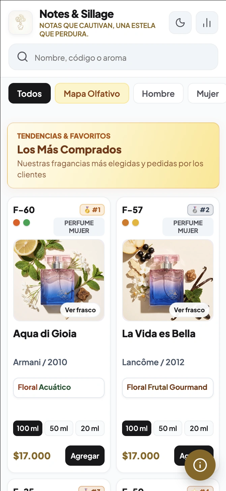
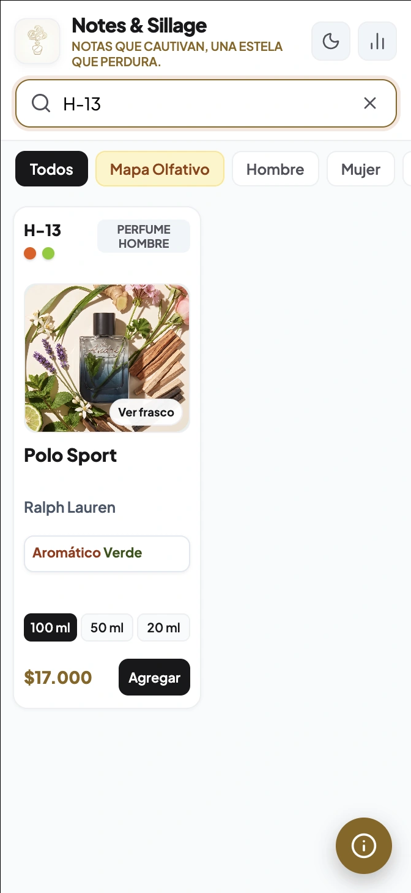
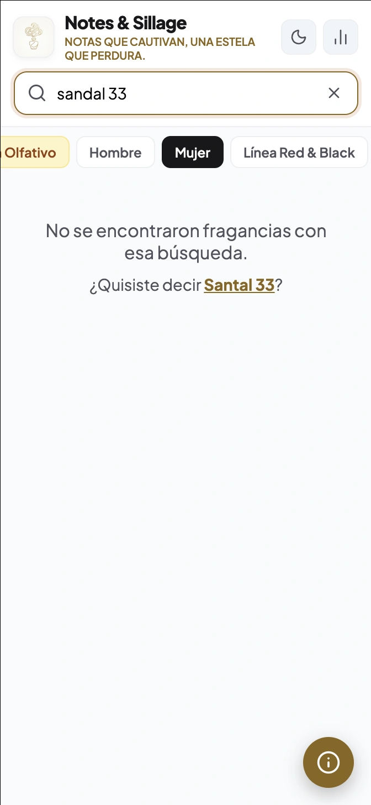
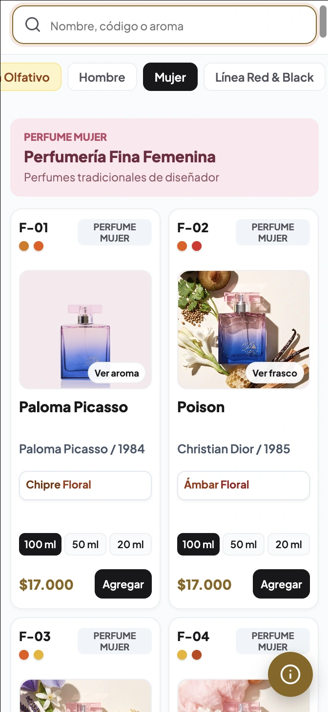
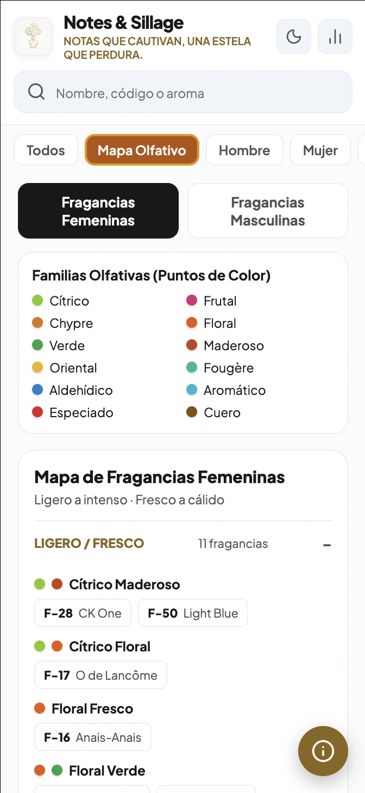
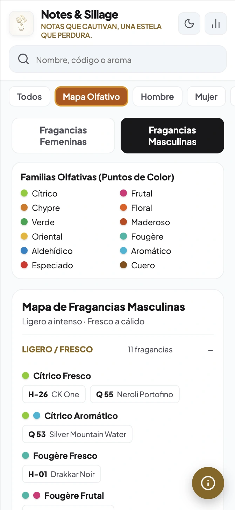
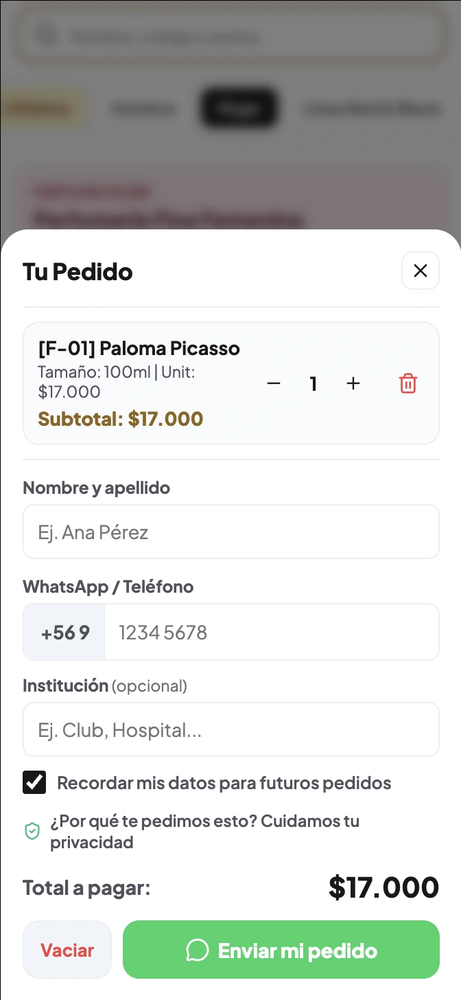
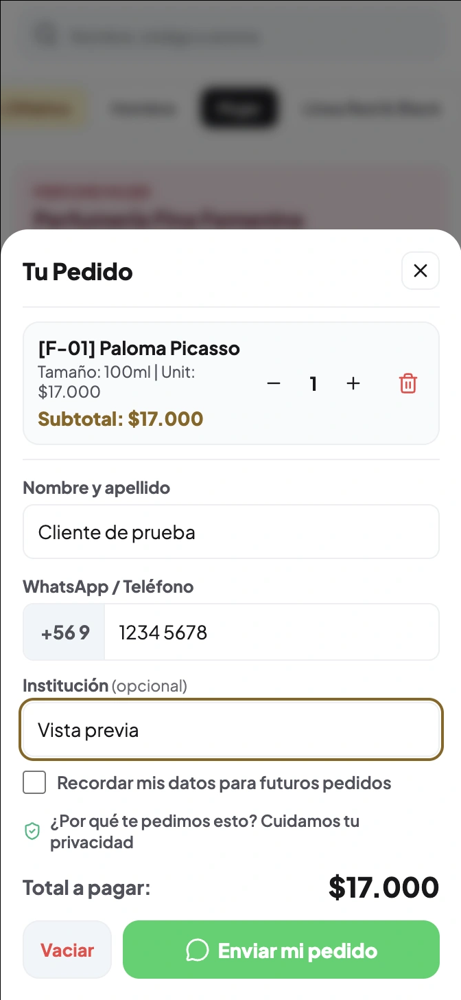
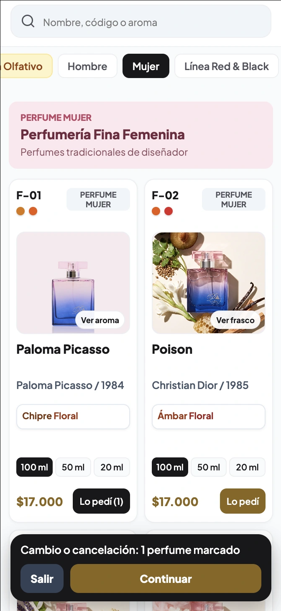
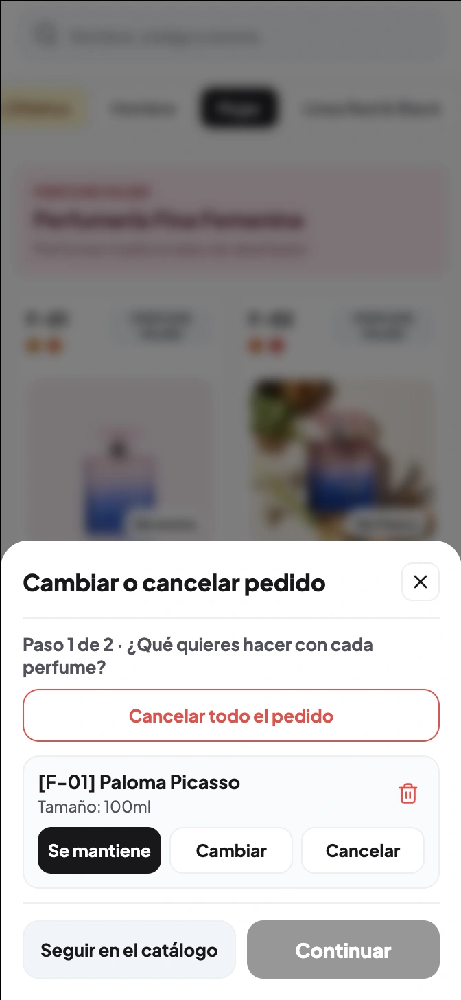

<div align="center">

# 🌸 Notes & Sillage — Plataforma Comercial & Catálogo Digital de Fragancias

**Emprendimiento propio de perfumería fina de inspiración en Chile**  
*Notas que cautivan, una estela que perdura.*

[](https://developer.mozilla.org/es/docs/Web/HTML)
[](https://developer.mozilla.org/es/docs/Web/CSS)
[](https://developer.mozilla.org/es/docs/Web/JavaScript)
[](https://firebase.google.com/)
[](https://www.cloudflare.com/)
[](https://ntfy.sh/)
[](https://pages.github.com/)
[](https://notes.cl/)

[🌐 Ver catálogo en producción: notes.cl](https://notes.cl/) &nbsp;|&nbsp; [📊 Ver planilla de ventas: notes.cl/ventas.html](https://notes.cl/ventas.html) &nbsp;|&nbsp; [📦 Historial proveedor: notes.cl/pedidos.html](https://notes.cl/pedidos.html)

</div>

---

## 📌 1. ¿Qué es Notes & Sillage?

**Notes & Sillage** es una solución web integral diseñada y construida para gestionar de punta a punta un emprendimiento real de venta de fragancias y perfumería fina de inspiración en Chile.

Nació para solucionar dos problemas críticos en el comercio digital independiente:
1. **Para los Clientes (Front-Office):** Evitar las interminables y desordenadas listas de precios en PDF o mensajes de texto por WhatsApp. El cliente accede a una experiencia ultra fluida, rápida y optimizada para celulares donde puede buscar fragancias por nombre, código o notas aromáticas, visualizar frascos, elegir tamaños, calcular totales y enviar su pedido con un toque a WhatsApp, registrándose automáticamente en la nube.
2. **Para el Emprendedor / Administrador (Back-Office):** Centralizar la contabilidad, cobranza y logística de compras en una única plataforma en tiempo real con **Google Firebase Firestore**. Permite agrupar pedidos en lotes para el proveedor, monitorear la meta de **envío gratis ($120.000)**, cobrar a clientes morosos mediante mensajes preescritos con un clic, gestionar los saldos y deducir capitales de inversión (ej. **$150.000 de capital de Octubre**).

El proyecto fue desarrollado bajo una arquitectura **Serverless Jamstack**, sin costes mensuales de servidores backend ni mantenimiento de bases de datos relacionales tradicionales, garantizando disponibilidad 24/7 y velocidad instantánea.

---

## 🏗️ 2. Arquitectura del Sistema

```text
                                  ┌───────────────────────────┐
                                  │   Cliente (Navegador)     │
                                  │   https://notes.cl        │
                                  └─────────────┬─────────────┘
                                                │
                                                ▼
┌─────────────────────────┐       ┌───────────────────────────┐       ┌─────────────────────────┐
│   GitHub Pages          │◄─────►│    Cloudflare Edge        │◄─────►│   Google Firestore      │
│   (Hosting Estático)    │       │   (DNS, SSL & Redirección)│       │   (Base de Datos NoSQL) │
└─────────────────────────┘       └─────────────┬─────────────┘       └────────────┬────────────┘
                                                │                                  │
                                                ▼                                  ▼
                                  ┌───────────────────────────┐       ┌─────────────────────────┐
                                  │   ntfy.sh (Push Alertas)  │◄──────┤   Planilla de Ventas    │
                                  │   (Móvil del Administrador│       │   https://notes.cl/     │
                                  │   pedidos & total acumul) │       │   ventas.html           │
                                  └───────────────────────────┘       └─────────────────────────┘
```

### Componentes clave
* **Catálogo para Clientes (`index.html` + `js/app.js`):** Interfaz pública mobile-first con renderizado reactivo, buscador con tolerancia a errores tipográficos, mapa olfativo, carrito flotante y asistente de cambios/cancelaciones.
* **Control de Ventas y Finanzas (`ventas.html` + `js/ventas.js`):** Hoja de cálculo interactiva conectada en vivo a Firestore. Calcula márgenes de ganancia unitarios y totales, agrupa compras por lotes para el proveedor, gestiona cobranzas y balances financieros.
* **Historial y Análisis de Pedidos Proveedor (`pedidos.html` + `js/pedidos.js`):** Cuadro de mando histórico con métricas consolidadas de compras a Parfums, análisis de productos más pedidos e inventario de regalías.
* **Capa de Notificaciones Inmediatas (ntfy.sh):** Envío automático de notificaciones push de alta prioridad al teléfono del administrador tanto del pedido unitario entrante como del total acumulado de compras pendientes.

---

## ✨ 3. Módulos y Funcionalidades Detalladas

### 3.1. Catálogo Digital y Carrito Interactivo (Front-Office)
| Característica | Descripción y Valor Comercial |
| :--- | :--- |
| 🔎 **Búsqueda Inteligente y Códigos** | Permite buscar por código de fragancia (ej. `H-13`, `F-57`), nombre del perfume original o notas aromáticas. Normaliza mayúsculas, minúsculas y tildes. |
| 💡 **Sugerencia "¿Quisiste decir...?"** | Algoritmo basado en distancia de Levenshtein que detecta errores tipográficos (ej. `sandal 33`) y sugiere el perfume exacto de la base de datos (`Santal 33`). |
| 🧭 **Mapa Olfativo Femenino y Masculino** | Brújula visual interactiva que organiza las fragancias desde frescas/ligeras hasta intensas/cálidas categorizadas por familias olfativas con guía cromática. |
| 🧴 **Selector de Formato Dinámico** | Cada perfume ofrece opciones de 100 ml, 50 ml y 20 ml, actualizando el precio y costo de forma inmediata. |
| 🛒 **Carrito Flotante con Persistencia** | Barra inferior persistente que calcula subtotales, permite editar unidades y valida el ingreso del nombre y teléfono del comprador. |
| 🔄 **Asistente de Cambios y Cancelaciones** | Módulo asistido unidad por unidad para clientes que ya enviaron un pedido y necesitan reemplazar un aroma o cancelar unidades antes de que se despache. |
| 📱 **Pedido Instantáneo por WhatsApp** | Genera el texto estructurado del pedido con un clic hacia el número del vendedor, dejando el carrito limpio para una nueva compra. |

---

### 3.2. Planilla de Ventas y Control de Cobranzas (Back-Office)
| Característica | Descripción y Valor Comercial |
| :--- | :--- |
| ⚡ **Sincronización en Vivo (Firestore)** | Lectura y escritura asíncrona en la colección `ventas` con estados dinámicos (`Pendiente`, `Pedido`, `Recepcionado`, `Entregado`, `Cancelado`). |
| 📦 **Agrupación por Lotes de Proveedor** | Clasifica automáticamente los perfumes en compras históricas cerradas o compras pendientes. Permite seleccionar pendientes y sellar un nuevo lote de pedido con fecha. |
| 🚚 **Monitoreo de Envío Gratis ($120.000)** | Barra e indicador en tiempo real en la cabecera de pendientes que calcula cuánto dinero en compras al proveedor falta para obtener **envío gratis** (leído dinámicamente de Firestore y editable). |
| 💰 **Módulo "Faltantes por Pagar"** | Vista filtrada exclusiva que reúne a todos los clientes con pedidos entregados o activos que aún no han pagado (`pagado === false`), con monto total por cobrar. |
| 📲 **Cobro Amable por WhatsApp en 1 Clic** | Botón directo de cobro que abre una conversación con mensaje preescrito amable, detallando el pedido, el total a transferir y los **datos de cuenta bancaria del vendedor** (Mercado Pago / Christian Fuentealba). |
| ✅ **Baja Inmediata al Marcar Pagado** | Botón directo "Marcar Pagado" que actualiza Firestore a `pagado: true`, emite una alerta flotante y **remueve al cliente de la tabla de faltantes en tiempo real**. |
| 📊 **Métricas y Rendimiento Financiero** | Tablero con tarjetas KPI (Venta Total, Ganancia Neta, Costo de Mercadería, Perfumes Vendidos, Margen Medio %) y gráficos interactivos con **Chart.js** (Top Fragancias, Top Instituciones y Top Clientes). |

---

### 3.3. Módulo "Gastos y Balances" y Capital de Octubre
Ubicado en la barra superior de `ventas.html`, este centro de configuración permite:
1. **Configuración de Envío Gratis:** Modificar en cualquier momento el umbral de envío gratis (por defecto `$120.000`), impactando de inmediato en el cálculo de pendientes y en las alertas móviles.
2. **Datos Bancarios de Cobranza:** Mantener actualizados el titular, RUT, banco, tipo de cuenta, número de cuenta y correo electrónico para las plantillas de WhatsApp sin tocar una sola línea de código.
3. **Balance Especial de Octubre ($150.000 de Capital):**
   * Incorpora un capital de **$150.000 CLP** generado en Octubre.
   * Se registra en los egresos y **se resta del total de ganancias de Octubre**, reflejando la rentabilidad neta real del negocio.
4. **Registro de Nuevos Gastos Operacionales:** Registro categorizado de gastos (Insumos, Bolsas, Fletes, Membresías) con impacto directo en los balances.

---

### 3.4. Sistema de Alertas Móviles Push (ntfy.sh)
Cuando un cliente confirma un pedido desde el catálogo digital, se activan dos despachos automáticos en segundo plano:
1. **Canal de Pedido Unitario (`ntfy.sh/pedidos-notesandsillage-2042`):**  
   Alerta con sonido y vibración indicando cliente, teléfono, institución, desglose de perfumes y enlace de contacto directo.
2. **Canal de Acumulado de Pendientes (`ntfy.sh/total-pedidos-pendientes-notes-and-sillage`):**  
   Alerta con el resumen consolidado de todos los pedidos pendientes acumulados, inversión requerida y el saldo restante exacto para alcanzar el envío gratis de $120.000 con el proveedor.

---

## 📸 4. Guía Visual del Catálogo (Docs e Imágenes)

A continuación se presentan las capturas oficiales del funcionamiento del catálogo.

| Portada y Catálogo Inicial | Búsqueda por Código |
| :---: | :---: |
|  |  |
| *Buscador, categorías por pestañas y tarjetas con formato y precio.* | *Resultado inmediato al escribir códigos como `H-13` o `F-57`.* |

| Sugerencia "¿Quisiste decir...?" | Notas Olfativas y Familia |
| :---: | :---: |
|  |  |
| *Corrección ortográfica inteligente contra el catálogo en vivo.* | *Distintivo cromático y familia olfativa por cada fragancia.* |

| Mapa Olfativo Femenino | Mapa Olfativo Masculino |
| :---: | :---: |
|  |  |
| *Fragancias femeninas ordenadas por intensidad y familias.* | *Distribución olfativa para fragancias masculinas.* |

| Carrito Flotante y Resumen | Confirmación antes de Enviar |
| :---: | :---: |
|  |  |
| *Edición de cantidades, datos del cliente y subtotal.* | *Paso de verificación previa al despacho del pedido.* |

| Modo Cambio en Catálogo | Decisión Unidad por Unidad |
| :---: | :---: |
|  |  |
| *Barra fija de edición de pedido existente.* | *Decisión individual: mantener, cambiar por otro aroma o cancelar.* |

---

## 🖼️ 5. Guía de Mantenimiento y Renovación de Imágenes

Para preservar este repositorio en el tiempo y permitir que un nuevo cliente o reclutador actualice las capturas de pantalla de la carpeta [`docs/img/`](docs/img/), sigue esta guía técnica:

### Especificaciones técnicas requeridas
* **Formato:** PNG optimizado o WebP sin pérdida.
* **Resolución recomendada para capturas móviles:** 1080 × 2400 px o proporción 9:19.5 (pantalla completa de smartphone moderno sin recortes de bordes).
* **Peso por archivo:** Mantener cada captura por debajo de los 250 KB mediante herramientas de compresión como `tinypng.com` o el comando `sips` en macOS.
* **Convención de nombres:**
  * `01-catalogo-inicio.png`: Portada principal del catálogo con barra de búsqueda visible.
  * `02-busqueda-por-codigo.png`: Resultado de escribir un código en el buscador.
  * `03-mapa-olfativo-mujer.png` / `04-mapa-olfativo-hombre.png`: Vistas de las brújulas olfativas.
  * `05-catalogo-mujer.png`: Listado de perfumería fina con tarjetas de fragancia.
  * `06-barra-de-carrito.png` / `07-resumen-del-pedido.png`: Carrito flotante y modal abierto.
  * `08-buscador-placeholder.png` / `09-sugerencia-busqueda.png`: Estados del buscador.
  * `10-notas-olfativas.png`: Detalle de una tarjeta mostrando puntos de color y notas.
  * `11-globo-ayuda.png`: Botón flotante inferior de cambios y cancelaciones.
  * `12-confirmar-pedido.png`: Modal "¿Ya terminaste tu pedido?".
  * `13-modo-cambio-catalogo.png` a `16-confirmar-cambio.png`: Flujo completo de modificación de pedido.

### Actualización rápida con terminal en macOS
```bash
# Redimensionar y optimizar una imagen nueva manteniendo la proporción
sips -Z 800 docs/img/01-catalogo-inicio.png
```

---

## 🌐 6. Configuración de Dominio y Cloudflare (`notes.cl` y `www.notes.cl`)

Para que el dominio [`notes.cl`](https://notes.cl/) y su subdominio `www.notes.cl` funcionen con cifrado HTTPS estricto y sin mostrar advertencias de seguridad ni errores de previsualización en WhatsApp:

### Diagnóstico resuelto
GitHub Pages utiliza un certificado Let's Encrypt exclusivo para el dominio exacto indicado en el archivo [`CNAME`](CNAME) (`notes.cl`). Si un usuario ingresa a `https://www.notes.cl` y Cloudflare está en modo "Solo DNS (nube gris)", GitHub Pages entrega el certificado `*.github.io`, lo que provoca la advertencia de navegador no seguro.

### Configuración en 3 pasos en Cloudflare:
1. **Activar Proxy (Nube Naranja):**
   * En el panel de Cloudflare de `notes.cl` $\rightarrow$ pestaña **DNS**.
   * Localiza el registro `CNAME` o `A` correspondiente a `www`.
   * Cambia el estado de "Solo DNS" (gris) a **"Con proxy" (naranja ☁️🧡)**.
   * Esto hace que Cloudflare termine el apretón de manos SSL con su certificado universal válido para `notes.cl` y `*.notes.cl`.
2. **Crear Regla de Redirección 301 (Redirect Rule):**
   * En Cloudflare $\rightarrow$ menú **Reglas** $\rightarrow$ **Reglas de redirección** (Redirect Rules) $\rightarrow$ Crear regla:
     * **Nombre:** "Redirigir www a dominio raíz".
     * **Si la solicitud coincide con:** Nombre de host igual a `www.notes.cl`.
     * **Tipo de redirección:** Redirección estática (301 Permanente).
     * **URL de destino:** `https://notes.cl/` (Preservar cadena de consulta activado).
3. **Verificación Open Graph en Redes y WhatsApp:**
   * Al estar la redirección 301 protegida por SSL en el borde de Cloudflare, los scrapers de WhatsApp, Telegram y Facebook acceden sin errores a `https://notes.cl/img/og-preview.jpg`, mostrando la tarjeta con imagen, título y descripción.

---

## 🛠️ 7. Tecnologías Empleadas

| Área | Herramientas y Librerías |
| :--- | :--- |
| **Frontend** | HTML5 semántico, CSS3 Vanilla con variables CSS y diseño responsive mobile-first. |
| **Lógica** | JavaScript Vanilla moderno (ES6+ Modules, Async/Await, Fetch API, LocalStorage). |
| **Backend / DB** | Google Firebase (Cloud Firestore NoSQL Database y Firebase Authentication). |
| **Gráficos** | [Chart.js 4.4](https://www.chartjs.org/) para visualización interactiva de ventas y ranking de fragancias. |
| **Íconos** | [Lucide Icons](https://lucide.dev/) (iconografía SVG modular y liviana). |
| **Notificaciones** | [ntfy.sh](https://ntfy.sh/) (API REST HTTP para alertas push inmediatas a smartphones Android/iOS). |
| **Infraestructura** | GitHub Pages (CI/CD continuo desde rama `main`), NIC Chile y Cloudflare. |

---

## 📂 8. Estructura del Repositorio

```text
notes-and-sillage/
├── CNAME                    # Dominio personalizado en GitHub Pages (notes.cl)
├── README.md                # Documentación exhaustiva y preservación técnica del proyecto
├── favicon.ico              # Ícono oficial del navegador
├── firestore.rules          # Reglas de seguridad de base de datos en Google Firebase
├── index.html               # Catálogo digital interactivo orientado a clientes
├── pedidos.html             # Historial mensual consolidado de compras al proveedor
├── ventas.html              # Planilla en vivo de ventas, finanzas, lotes y faltantes por pagar
├── css/
│   ├── estilos.css          # Estilos del catálogo, buscador, animaciones y tema oscuro
│   ├── pedidos.css          # Estilos del cuadro de mando del historial de pedidos
│   └── ventas.css           # Estilos de la planilla de ventas, modales y tablas financieras
├── js/
│   ├── app.js               # Lógica del catálogo: carrito, buscador, sugerencias y ntfy
│   ├── firebase-config.js   # Conexión, autenticación y operaciones CRUD en Firestore
│   ├── pedidos-data.js      # Dataset histórico consolidado de compras a Parfums
│   ├── pedidos.js           # Lógica interactiva de pedidos.html
│   └── ventas.js            # Lógica completa de ventas.html, lotes, balances y cobranzas
├── img/                     # Fotografías de productos, logos, banners y og-preview
└── docs/
    ├── certificados/        # Certificado de registro oficial NIC Chile (.cl)
    └── img/                 # Capturas oficiales documentadas para este README
```

---

## 🚀 9. Ejecución Local en Desarrollo

El proyecto no requiere Node.js, `npm` ni compiladores. Para levantarlo en tu equipo local:

```bash
# 1. Clonar el repositorio
git clone https://github.com/deralexsander/notes-and-sillage.git
cd notes-and-sillage

# 2. Iniciar servidor local liviano con Python 3
python3 -m http.server 8000
```

Luego abre tu navegador en:
* Catálogo de Clientes: `http://localhost:8000/index.html`
* Planilla de Ventas: `http://localhost:8000/ventas.html`
* Historial Proveedor: `http://localhost:8000/pedidos.html`

---

## 👤 Autor y Contacto

Proyecto concebido, diseñado y programado por **Alexsander Muñoz**.  
* [GitHub: @deralexsander](https://github.com/deralexsander)  
* [Sitio Oficial en Producción: notes.cl](https://notes.cl/)

---
<div align="center">
Hecho con dedicación para <strong>Notes & Sillage</strong> 🌸
</div>
